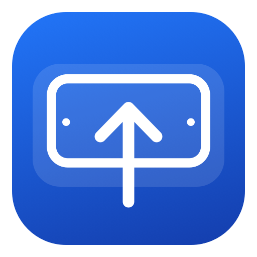

<p align="center"></p>

# Switch 传输助手 · macOS

面向中文用户的 Mac 原生 DBI USB 传输工具。连接 Switch、添加安装包、开始传输，整个流程在一个窗口完成。

**[下载 v1.0.0 公开预览版](https://github.com/WePart/switch-transfer-mac/releases/tag/v1.0.0)** · [构建说明](BUILD.txt) · [反馈问题](https://github.com/WePart/switch-transfer-mac/issues)

> 当前安装包适用于 **Apple 芯片 Mac，macOS 26 或更新版本**。已完成协议模拟和 Mac 界面检查；真实 Switch 的完整传输与安装仍待验证。

## 功能

- SwiftUI / AppKit 原生中文界面，跟随系统明暗外观。
- 三步操作引导，自动检查 USB 设备，区分设备识别和 DBI 握手。
- 拖入文件、批量选文件、导入文件夹，支持中文文件名。
- 支持 `NSP`、`NSZ`、`XCI`、`XCZ`；提示压缩包、空文件、重名和失效文件。
- 自动保存文件列表；移除项目不会删除原文件。
- 显示当前文件已发送的数据量和平均速度，支持停止与断线等待重连。
- 内置连接排查说明、诊断日志及日志导出。
- 自带 Python 和 USB 运行库，成品运行不需要终端、Homebrew 或另装 Python。

## 安装

1. 在 [Releases](https://github.com/WePart/switch-transfer-mac/releases) 下载 `SwitchTransfer-1.0.0-macOS26-arm64.dmg`。
2. 打开 DMG，把 **Switch 传输助手** 拖入 **应用程序**。
3. 在“应用程序”中双击打开。

发布包采用本地 ad-hoc 签名，尚未进行 Apple Developer ID 签名或公证，首次打开可能被 macOS 拦截。请按系统提示处理；也可以使用下方步骤从源码构建。

Intel Mac 和 macOS 25 或更早版本不在此安装包的兼容范围内。系统下限取决于内置 USB 动态库，不能通过修改应用描述绕过。

## 如何使用

1. **连接 Switch**：用支持数据传输的 USB 线直连 Mac；若系统询问是否允许配件连接，选择允许。
2. **打开 DBI 后端**：Switch 上选择 **从 DBIbackend 安装 / Install title from DBIbackend**，停留在等待后端的画面。
3. **添加并传输**：把安装包拖进应用，点击 **开始传输**，再在 Switch 上选中要安装的文件并开始安装。

需要 Switch 已经能够运行 DBI。本项目不包含 Switch 端程序、游戏文件或固件。

### 常见问题

**Mac 没有识别到 Switch**

唤醒并解锁 Mac，换一根支持数据传输的线或另一个 USB 接口，暂时绕开扩展坞，然后点击“重新检查”。

**已识别设备，但没有文件列表**

确认 Switch 选择的是“从 DBIbackend 安装”。`Run MTP responder` 是另一种模式。退出 OpenMTP、Android File Transfer 或其他 DBI 后端，再重新插拔数据线并进入后端模式。

**ZIP、RAR、7Z 能直接传吗？**

请先解压，再添加其中的安装包。金手指、模组和存档属于普通文件，不能作为安装包通过此工具安装。

**中断后会自动续传吗？**

应用会等待重新连接，但不会自动续传或重新安装。重连后需要在 Switch 重新选择安装。传输期间请勿移动、修改或删除源文件。

**进度到 100% 就安装好了吗？**

进度表示电脑已发送的文件数据。Switch 仍可能需要处理和验证文件，安装结果以 Switch 屏幕为准。

## 本地数据

应用本身没有网络请求，也不会自动上传文件或日志。

- `~/Library/Application Support/SwitchTransfer/files.json`：最近选择的文件列表。
- `~/Library/Application Support/SwitchTransfer/last-session.log`：最近一次会话日志。

提交问题时，建议提供 macOS 版本、Mac 芯片、DBI 版本、界面提示及复现步骤。日志可能包含文件名；分享前请移除不想公开的信息。

## 从源码构建

需要 Apple 芯片 Mac、macOS 26+、Xcode Command Line Tools、带共享库的 Python 3.12 和 arm64 libusb。

```sh
git clone https://github.com/WePart/switch-transfer-mac.git
cd switch-transfer-mac
python3.12 -m venv .venv
source .venv/bin/activate
python -m pip install -r requirements-build.txt
python -m unittest -v test_backend
python build.py ./release
```

如未安装构建工具，可通过 `xcode-select --install` 安装 Command Line Tools；使用 Homebrew 的开发环境可通过 `brew install python@3.12 libusb` 安装其余依赖。

构建脚本默认查找 `/opt/homebrew/opt/libusb/lib/libusb-1.0.dylib`。可以用 `DBI_LIBUSB_PATH` 指向其他兼容 arm64 动态库；设置此变量时，将对应许可文件作为 `COPYING` 放在该库的上两级目录。

构建输出为 `release/Switch 传输助手.app`。完整参数和组件说明见 [BUILD.txt](BUILD.txt)。

## 项目结构

| 文件 | 用途 |
| --- | --- |
| `App.swift` | 原生界面、文件管理、工作进程通信与状态显示 |
| `backend.py` | DBI0 USB 协议和后台传输服务 |
| `test_backend.py` | 协议边界、文件分块和服务生命周期测试 |
| `build.py` | 收集依赖、构建 `.app`、本地签名和自检 |
| `MakeIcon.swift` | 原生绘制应用图标 |
| `.github/workflows/tests.yml` | 自动运行协议测试 |

## 验证状态

本版本包含 17 项协议及服务生命周期测试：中文文件名、分块与偏移、重复读取、越界请求、异常应答、提前 EOF、部分写入、取消、MTP 模式提示和断线重连。

已在 Apple 芯片 Mac / macOS 26.6.2 检查独立启动、内置 USB 库加载、代码签名完整性、文件夹导入、格式与同名提示、失效文件拦截、重开列表恢复及诊断日志导出。

这些验证不等同于真实 Switch 传输成功。本次公开版本标记为预览版，欢迎提交具体设备与 DBI 版本的测试反馈。

## 来源与许可

- 原项目：[GuangLun2000/DBI-backend-for-switch](https://github.com/GuangLun2000/DBI-backend-for-switch)，作者 CAI（Hanlin Cai），原项目致谢 dev#Mikami。
- DBI / DBI0 协议参考：[rashevskyv/dbi](https://github.com/rashevskyv/dbi)，DBI 作者 duckbill。
- 本仓库提供重新组织的 USB 工作进程与 Mac 原生界面，与 Nintendo 无官方关联。

完整来源与第三方组件许可见 [THIRD-PARTY.txt](THIRD-PARTY.txt) 和 [licenses/](licenses/)。原项目在所参考提交中没有标准许可证；本仓库暂未声明统一开源许可证，也不替上游授予额外授权。公开可见与取得使用、修改、再分发许可是不同事项。

发布页另附内置 libusb 1.0.30 的对应源码包；其他运行库的许可文本同时包含在应用包中。
